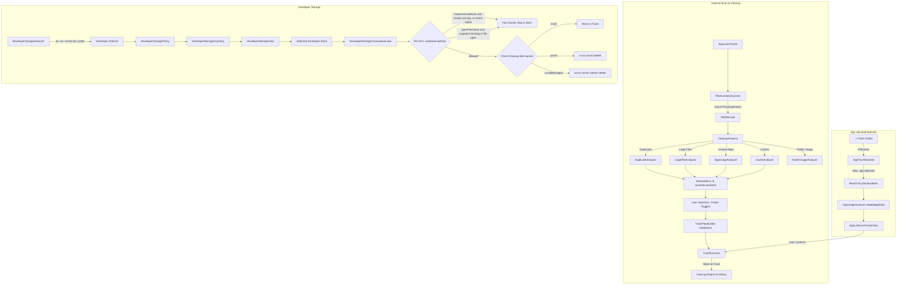

# LittleTidy — File Map and Data Flow

Moved out of AGENTS.md so that file stays short. This map can lag behind the code: when it disagrees with `Sources/`, the code wins, and the safety invariants in [AGENTS.md](../AGENTS.md) win over both.

Not yet described below: `Sources/LittleTidyCore/SystemCare/` (`BoundedCommandRunner`, `FolderExplorer`, `GitWorktreeManager`, `SystemCareAnalyzer`, `SystemCareModels`), `Analyzers/APFSReclaimEstimator.swift`, `Analyzers/ClaudeSessionRegistry.swift`, `Analyzers/LocalSnapshotInventory.swift`, `Execution/DeletionPreflight.swift`, `Execution/HomebrewCleanup.swift`, `Execution/LocalSnapshotReleaser.swift`.

## 1. `Sources/LittleTidyCore` (Engine & Logic)

#### Models (`Sources/LittleTidyCore/Models/`)
- [`Models.swift`](../Sources/LittleTidyCore/Models/Models.swift): Core domain types:
  - `Confidence` (`high`, `medium`, `low`): Confidence in cleanup safety.
  - `CleanupCategory` (`duplicate`, `largeFile`, `unusedApp`, `cache`).
  - `DeletionMode` (`moveToTrash`, `permanentDelete`).
  - `FileRecord`: Metadata snapshot of an indexed file (URL, logical and allocated size, physical file identity, dates, content type, hidden status).
  - `DuplicateGroup`: Set of byte-identical files, content SHA-256, recommended keep file, reclaimable bytes.
  - `LargeFileCandidate`: File exceeding size threshold, scoring explanation, confidence.
  - `RelatedAppData`: URL, size, and category of an app's leftover files (Application Support, Caches, Preferences, etc.).
  - `AppUsageRecord`: App bundle metadata, Spotlight last-opened date, app size, related leftovers.
  - `TrashPlan` & `TrashPlanItem`: Validated batch of files ready for trashing.
- [`DeveloperStorageModels.swift`](../Sources/LittleTidyCore/Models/DeveloperStorageModels.swift):
  - `DeveloperStorageCategory` (14 categories: `simulatorDevices`, `simulatorRuntimes`, `xctestDevices`, `derivedData`, `projectBuildFolders`, `deviceSupport`, `packageCaches`, `aiModelsAndAgents`, `aiCaches`, `aiGeneratedArtifacts`, `archives`, `androidEmulators`, `testArtifacts`, `otherDeveloperData`).
  - `StorageRecommendation` (`recommended`, `review`, `protected`, `unclassified`).
  - `StorageRecoverability` (`trashRestorable`, `recreatable`, `reinstallable`, `irreversible`, `unknown`).
  - `StorageActivityState` (`active`, `recentlyUsed`, `inactive`, `unavailable`, `unknown`).
  - `DeveloperCleanupMechanism` (`trash`, `simctl`, `xcodeManaged`, `manual`, `unsupported`).
  - `CleanupConsequence` (`negligible`, `temporarySlowdown`, `redownloadRequired`, `debuggingImpact`, `dataLossRisk`, `unknown`).
  - `DeveloperStorageItem`: Single diagnosed developer storage entity.
  - `DeveloperStorageInventory`: Aggregated scan results, access issues, and convenience byte calculators.
- [`AppUninstallEvent.swift`](../Sources/LittleTidyCore/Models/AppUninstallEvent.swift): Event payload when an app bundle is trashed, containing app info and detected leftover paths.

#### Policies (`Sources/LittleTidyCore/Policies/`)
- [`DeveloperStoragePolicy.swift`](../Sources/LittleTidyCore/Policies/DeveloperStoragePolicy.swift): Pure mapping function from `(DeveloperStorageCategory, isAvailable, isActive)` to `DeveloperStorageDecision`. Encapsulates recommendation rules, recoverability, and consequences.
- [`ScanOptions.swift`](../Sources/LittleTidyCore/Policies/ScanOptions.swift): Options controlling scan scope (`includeHiddenFiles`, `includeSystemFolders`, `followSymbolicLinks`, `includeCaches`, thresholds) and stream events (`ScanEvent`, `ScanProgress`, `ScanSummary`).
- [`FullDiskAccess.swift`](../Sources/LittleTidyCore/Policies/FullDiskAccess.swift): Probes TCC-protected locations (`~/Library/Safari`, `~/Library/Mail`, `~/Library/Suggestions`) to test whether Full Disk Access is granted, plus settings deep-link URL.

#### Analyzers (`Sources/LittleTidyCore/Analyzers/`)
- [`FileInventoryScanner.swift`](../Sources/LittleTidyCore/Analyzers/FileInventoryScanner.swift): Traverses scan roots via `FileManager.DirectoryEnumerator`, filtering excluded/system dirs, checking iCloud ubiquity download state, emitting `AsyncThrowingStream<ScanEvent, Error>`.
- [`DuplicateAnalyzer.swift`](../Sources/LittleTidyCore/Analyzers/DuplicateAnalyzer.swift): 3-stage duplicate pipeline:
  1. Group by exact byte size.
  2. Quick 64KB fingerprint (reads head, middle, tail of file; computes SHA-256).
  3. Full SHA-256 chunked hash verification.
  - Collapses hard-linked paths that refer to the same physical file so they are not reported as reclaimable copies.
  - Keep strategies: `smart` (prefers non-downloads, non-hidden, shallow paths), `oldest`, `newest`, `preferNonDownloads`, `shortestPath`.
- [`LargeFileAnalyzer.swift`](../Sources/LittleTidyCore/Analyzers/LargeFileAnalyzer.swift): Evaluates files >= threshold (default 500MB), excludes protected packages (`.photoslibrary`, `.xcodeproj`, `.vmwarevm`), assigns score based on size, age, Downloads location, and extension (`.dmg`, `.pkg`, `.mov`, etc.).
- [`CacheAnalyzer.swift`](../Sources/LittleTidyCore/Analyzers/CacheAnalyzer.swift): Locates regenerable caches across macOS hierarchies and project workspaces:
  - Xcode DerivedData (`~/Library/Developer/Xcode/DerivedData`).
  - Standard user caches (`~/Library/Caches/*`).
  - Sandboxed app caches, temp files, and logs (`~/Library/Containers/*/Data/{Library/Caches,tmp,Library/Logs}`).
  - Group Container cache subdirectories (`~/Library/Group Containers/*/{Library/Caches,Caches}`).
  - macOS framework caches (`~/Library/HTTPStorages/*/fsCachedData`, `~/Library/WebKit/*/WebsiteData/{NetworkCache,CacheStorage}`, `~/Library/Saved Application State/*.savedState`, `~/Library/Logs/*`).
  - Electron/Chromium regenerable sub-caches inside `~/Library/Application Support/<App>/` (`Cache`, `Code Cache`, `GPUCache`, `DawnCache`, `ShaderCache`, `CachedData`, `Crashpad/completed`, `Service Worker/{CacheStorage,ScriptCache}`).
  - Creative & media caches (Adobe Media Cache, Peak Files, Spotify PersistentCache, Steam httpcache).
  - 45+ global developer tool caches (`.npm`, `.yarn`, `.cache/{pip,uv,pypoetry,pdm,pipenv,pre-commit,deno,turbo,puppeteer,playwright,prisma,coursier,go-build,composer,ccache,vcpkg,bazel}`, `.cargo`, `pnpm`, `.bun`, `.gradle`, `.ivy2`, `.sbt`, `conda`, `go/pkg/mod/cache`, `.gem`, `.bundle/cache`, `.pub-cache`, `NuGet`, `.conan2`, `.terraform.d/plugin-cache`, `.kube`, `.node-gyp`, `.tuist/Cache`).
  - Verified per-project build folders via [`ProjectBuildScanner.swift`](../Sources/LittleTidyCore/Analyzers/ProjectBuildScanner.swift) when `scanRoots` are provided.
  - Maps bundle IDs to human-readable names (`friendlyName`).
- [`ProjectBuildScanner.swift`](../Sources/LittleTidyCore/Analyzers/ProjectBuildScanner.swift): Scans project roots for verified per-project build and local dependency directories (`.build`, `target`, `build`, `cmake-build-*`, `.gradle`, `.kotlin`, `node_modules`, `.next`, `.nuxt`, `.svelte-kit`, `.astro`, `.turbo`, `.parcel-cache`, `.angular/cache`, `.venv`/`venv`, `.pytest_cache`, `.mypy_cache`, `.ruff_cache`, `.tox`, `.nox`, `Pods`, `Carthage/Build`, Unity `Library`/`Temp`, Unreal `Intermediate`/`Saved/Logs`, `.godot`, `.zig-cache`/`zig-out`, `bin`/`obj`, `_build`, `.stack-work`/`dist-newstyle`, `.terraform`, `bazel-*`, and `CACHEDIR.TAG`). Enforces the **Sibling Manifest Invariant** (never matches by folder name alone) and uses `BatchDiskUsageMeasurer` (`du -x -sk`) for fast sizing.
- [`AppUsageAnalyzer.swift`](../Sources/LittleTidyCore/Analyzers/AppUsageAnalyzer.swift): Scans `/Applications` and `~/Applications`. Reads bundle Info.plist. Fetches last-opened date via Spotlight metadata (`MDItemCreate` / `kMDItemLastUsedDate`), falling back to filesystem dates. Classifies into `probablyUnused` (>=180 days), `possiblyUnused` (>=90 days), `recentlyUsed`. Locates related app data in `~/Library/` by exact bundle identifier.
- [`DeveloperStorageAnalyzer.swift`](../Sources/LittleTidyCore/Analyzers/DeveloperStorageAnalyzer.swift): Actor diagnosing Apple, multi-language, and AI developer data:
  - Uses direct `/usr/bin/du -sk` execution for multi-gigabyte CoreSimulator directories (significantly faster than recursive URL enumeration).
  - Uses volume capacity metadata for mounted Simulator runtimes to avoid traversing mounted OS disk images.
  - Invokes `xcrun simctl list --json` and `xcrun simctl runtime list --json`.
  - Analyzes per-project DerivedData, multi-platform DeviceSupport (`iOS`, `watchOS`, `tvOS`, `visionOS`, `macOS`, `CoreDeviceData`), Archives, XCTest clones (`simctl --set testing`), Homebrew (`brew cleanup --dry-run`), 45+ Package Caches (SwiftPM, CocoaPods, Carthage, npm, Yarn, pnpm, Bun, pip, uv, Poetry, Cargo, Gradle, Maven, SBT, Go, Pub, NuGet, Conan, ccache, Bazel, Tuist, Playwright/Cypress/Puppeteer browsers), verified per-project build folders (`projectBuildFolders`), Android AVDs, AI models (Ollama, HuggingFace, PyTorch, MLX, Whisper, CLIP, llama.cpp, LM Studio, Jan), regenerable AI/IDE caches & logs (Claude, Cursor, Codex, Antigravity, Windsurf, Continue, Gemini, VS Code, Zed, JetBrains), and review-only AI session artifacts.
  - Calculates unallocated CoreSimulator remainder storage.
- [`FolderUsageAnalyzer.swift`](../Sources/LittleTidyCore/Analyzers/FolderUsageAnalyzer.swift): Aggregates indexed file records into first-level folders under each scan root for Storage Map treemap visualization without re-traversing the disk.
- [`CleanupAnalysis.swift`](../Sources/LittleTidyCore/Analyzers/CleanupAnalysis.swift): Async facade running the Sendable duplicate, large-file, and folder-usage analyzers concurrently while filesystem-bound app/cache analysis remains on the calling task, then combining everything into a single `CleanupAnalysisResult`.

#### Execution (`Sources/LittleTidyCore/Execution/`)
- [`TrashPlanBuilder.swift`](../Sources/LittleTidyCore/Execution/TrashPlanBuilder.swift): Validates that candidates are inside approved roots, are not system apps, are not symlinks, and will not wipe out an entire duplicate group.
- [`TrashExecutor.swift`](../Sources/LittleTidyCore/Execution/TrashExecutor.swift): Executes trash plan via `FileManager.default.trashItem(at:resultingItemURL:)` (or `removeItem` if permanent deletion was requested). Returns `trashed`, `failed`, and `skipped` lists.
- [`DeveloperStorageCleanupExecutor.swift`](../Sources/LittleTidyCore/Execution/DeveloperStorageCleanupExecutor.swift): Actor executing developer storage deletions:
  - Applies each item's `xcodeActivityRule` before acting on it: `requiresXcodeQuit` items are skipped while Xcode runs; `openFileCheck` items need a fresh open-file snapshot with nothing open inside them (see "Xcode Lock Guard" in AGENTS.md).
  - Handles `.trash` mechanism items.
  - Handles `.simctl` device deletions (re-verifying device state is not `Booted`).
  - Handles `.xcodeManaged` runtime deletions (re-verifying no dependent booted simulators).
- [`DeveloperToolActivityChecker.swift`](../Sources/LittleTidyCore/Execution/DeveloperToolActivityChecker.swift): Runs `/usr/bin/pgrep -x Xcode`. Fails closed (returns `true` if process check errors).
- [`DeveloperToolCommandClient.swift`](../Sources/LittleTidyCore/Execution/DeveloperToolCommandClient.swift): Actor wrapping `Process` execution with standard pipes, termination status, and cancellation handling.
- [`SimulatorInventoryParser.swift`](../Sources/LittleTidyCore/Execution/SimulatorInventoryParser.swift): Robust JSON parser for `simctl list --json` and `simctl runtime list --json`.

#### Watchers (`Sources/LittleTidyCore/Watchers/`)
- [`AppTrashWatcher.swift`](../Sources/LittleTidyCore/Watchers/AppTrashWatcher.swift): Monitors `~/.Trash` via macOS `FSEventStream`. When an `.app` bundle is moved to the Trash by the user in Finder, it parses its `Info.plist`, identifies leftover files in `~/Library/`, and triggers an `AppUninstallEvent` to prompt the user.

---

## 2. `Sources/LittleTidy` (Application & UI)

#### Application Lifecycle (`Sources/LittleTidy/App/`)
- [`LittleTidyApp.swift`](../Sources/LittleTidy/App/LittleTidyApp.swift): App entry point (`@main`), window setup (`minWidth: 980, minHeight: 640`), `Settings` scene, `AppDelegate` registering notification delegate and Sparkle updater.
- [`UpdaterManager.swift`](../Sources/LittleTidy/App/UpdaterManager.swift): Sparkle `SPUStandardUpdaterController` wrapper managing appcast updates.

#### State Stores (`Sources/LittleTidy/State/`)
- [`ScanReviewStore.swift`](../Sources/LittleTidy/State/ScanReviewStore.swift): Central `@MainActor` `ObservableObject` holding the entire UI state:
  - Scan state, live progress counters, active phase, scan issues.
  - Scan roots, app roots, options, selection tracking.
  - Developer storage inventory, active selection, and cleanup execution.
  - App leftover prompt state (`pendingUninstallEvent`).
  - Prepares `TrashPlan` and coordinates `TrashExecutor`.
  - Coordinates with `FolderBookmarkStore`, `ScanPreferencesStore`, and `CleanupHistoryStore`.
- [`ScanPreferencesStore.swift`](../Sources/LittleTidy/State/ScanPreferencesStore.swift): Loads and saves user preferences to `UserDefaults`.
- [`CleanupHistoryStore.swift`](../Sources/LittleTidy/State/CleanupHistoryStore.swift): Persists historical records of cleanup runs (`CleanupHistoryEntry`) including date, bytes freed, and per-category breakdowns.
- [`FolderBookmarkStore.swift`](../Sources/LittleTidy/State/FolderBookmarkStore.swift): Manages security-scoped bookmarks so user-approved directories persist across app launches.

#### Features & Views (`Sources/LittleTidy/Features/`)
- `Root/`
  - [`ContentView.swift`](../Sources/LittleTidy/Features/Root/ContentView.swift): Root `NavigationSplitView`, drag-and-drop folder/app drop receiver, leftover sheet presentation.
- `Sidebar/`
  - [`SidebarView.swift`](../Sources/LittleTidy/Features/Sidebar/SidebarView.swift): Sidebar navigation divided into 3 groups (`System`, `Cleanup`, `Review`).
- `Overview/`
  - [`OverviewView.swift`](../Sources/LittleTidy/Features/Overview/OverviewView.swift): Dashboard showing scanned stats, quick-action cards, access readiness list, live scanning progress bar, and scan issue disclosures.
- `DeveloperStorage/`
  - [`DeveloperStorageView.swift`](../Sources/LittleTidy/Features/DeveloperStorage/DeveloperStorageView.swift): Dedicated developer storage view: category cards, recommendation badges, active Xcode warning banner, simulator details, and cleanup action buttons.
- `ReviewList/`
  - [`ReviewListView.swift`](../Sources/LittleTidy/Features/ReviewList/ReviewListView.swift): Detailed list/table of items for a selected category, checkboxes, sort options, search bar, and item inspector sidebar.
- `CleanupPlan/`
  - [`CleanupPlanView.swift`](../Sources/LittleTidy/Features/CleanupPlan/CleanupPlanView.swift): Pre-execution review screen. Summarizes selected bytes, risk breakdown, irreversible action warnings, execution trigger button, and post-cleanup result report.
- `StorageMap/`
  - [`StorageMapView.swift`](../Sources/LittleTidy/Features/StorageMap/StorageMapView.swift): Interactive squarified treemap representing disk usage by folder, with "Reveal in Finder" actions.
- `AppUninstall/`
  - [`AppLeftoverPromptView.swift`](../Sources/LittleTidy/Features/AppUninstall/AppLeftoverPromptView.swift): Modal dialog presented when an app is trashed, listing related caches/preferences and offering selective deletion.
  - [`AppUninstallNotificationManager.swift`](../Sources/LittleTidy/Features/AppUninstall/AppUninstallNotificationManager.swift): Manages user notification authorizations and click-to-review handlers.
- `Settings/`
  - [`SettingsView.swift`](../Sources/LittleTidy/Features/Settings/SettingsView.swift): Multi-tab macOS settings window for scan rules, thresholds, developer options, updates, and permanent deletion toggle.
- `Detail/`
  - [`DetailView.swift`](../Sources/LittleTidy/Features/Detail/DetailView.swift): Router view switching between Overview, ReviewList, DeveloperStorage, StorageMap, and CleanupPlan based on sidebar selection.

#### UI Components (`Sources/LittleTidy/UIComponents/`)
- [`CleanerPalette.swift`](../Sources/LittleTidy/UIComponents/CleanerPalette.swift): Semantic color extensions (`cleanerSuccess`, `cleanerWarning`, `cleanerInfo`, `cleanerDanger`) tied to AppKit dynamic colors.
- [`CleanerSurface.swift`](../Sources/LittleTidy/UIComponents/CleanerSurface.swift): Tahoe/macOS styled surfaces (`cleanerSurface`, `cleanerSubtleSurface`, `cleanerInteractiveSurface`).
- [`ByteCountFormatter+Cleaner.swift`](../Sources/LittleTidy/UIComponents/ByteCountFormatter+Cleaner.swift): Standardized byte formatting helper.
- [`QuickLookPreviewController.swift`](../Sources/LittleTidy/UIComponents/QuickLookPreviewController.swift): QuickLook preview integration.
- [`FullDiskAccess+AppKit.swift`](../Sources/LittleTidy/UIComponents/FullDiskAccess+AppKit.swift): AppKit helper to open macOS System Settings directly to Full Disk Access.

---

## 3. End-to-End Data Flow

